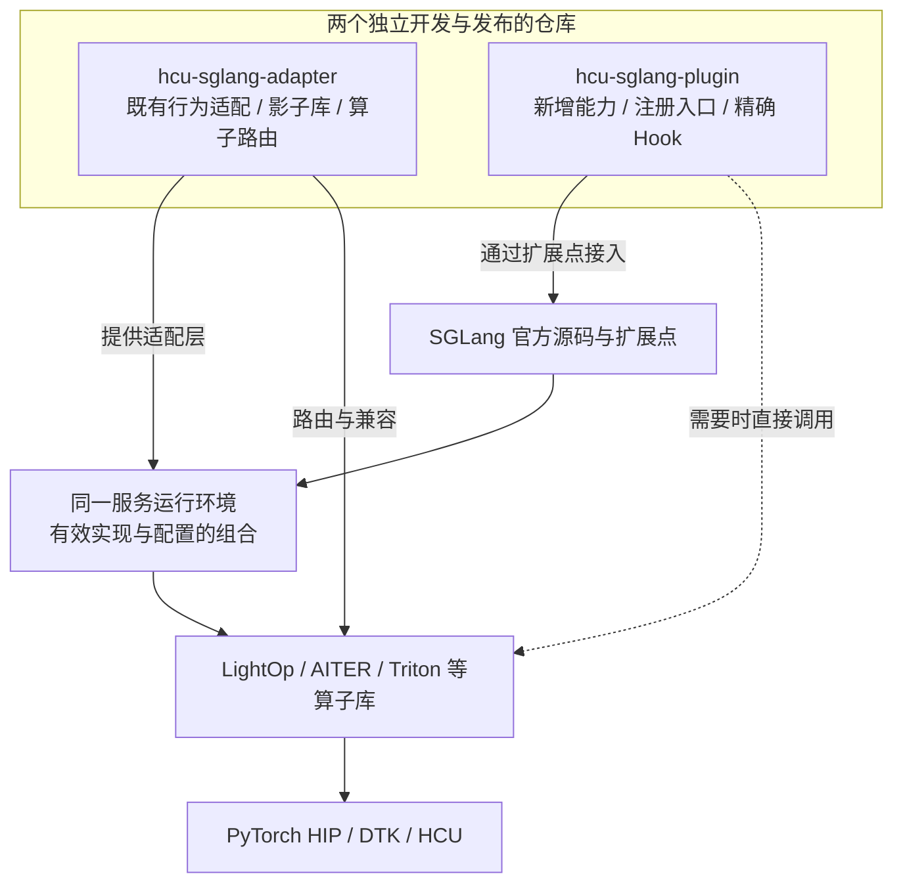
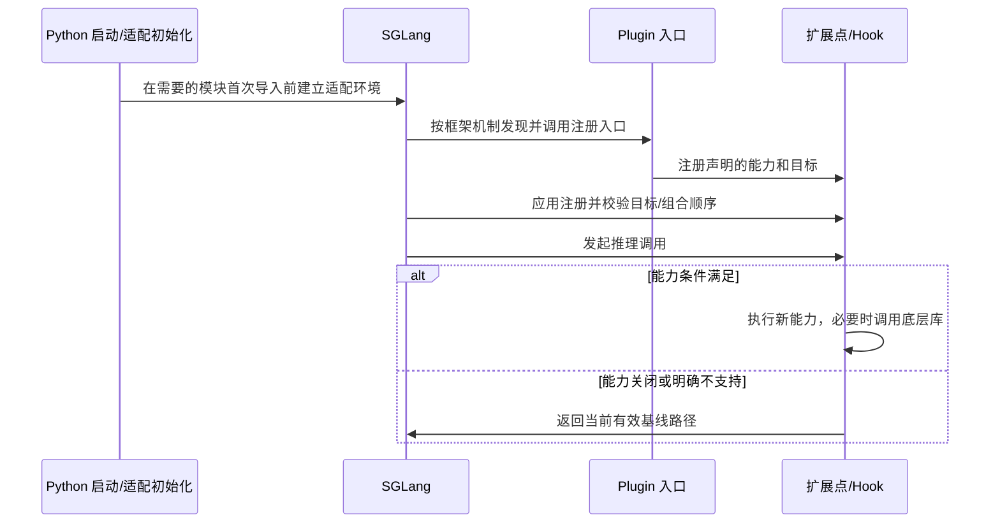

# 架构设计：独立开发与组合运行

> **本文用途**：解释 adapter、plugin、SGLang 与算子库的关系，定义本仓设计目标、现有目录和运行时职责，并给出导航与协作入口。用于评审方案和规划实现；具体操作见 [开发指南](plugins.md)，职责规则见 [治理](governance.md)。

## 1. 设计目标与当前阶段

| 目标 | 设计要求 | 当前状态 |
|---|---|---|
| 独立开发 | adapter/plugin 各自维护代码、版本与验证，不把两个仓库合成一个 glue 单体 | 文档与职责契约已建立 |
| 组合运行 | 同一个 SGLang 环境可同时使用 adapter 与 plugin，显式验证目标冲突及加载顺序 | 运行时已迁入；组合兼容按固定版本和配置验收 |
| 可追溯扩展 | 新能力通过 seam/注册/窄 Hook 接入，记录目标、条件、依赖和回退 | Skill、迁移台账与工具已提供 |
| 可验证交付 | 接线、数值、Graph、服务与性能证据逐层递进 | 结构门禁与运行时合同已提供；设备、Graph 与模型结论按证据分别记录 |
| 可维护文档 | 导航、设计、操作、规则与历史证据各有归属 | 文档按 [文档索引](README.md) 组织 |

本仓目前包含 `hcu_sglang` 运行时、方法、Skill 与工具。当前目录与职责见第3、4节；分版本实现与验证记录见 [开发迁移记录](hcu-sglang-development.md)。旧包名提案不作为当前接口。**独立开发不等于没有运行时依赖**：某能力若需要 adapter 提供的符号或环境行为，必须声明并验证这个依赖。

## 2. 运行时组合关系



图中两条仓库线汇入同一运行环境，**没有按需求二选一的分支**。职责判别只决定某份实现由谁维护；一个功能可拆为 adapter 的 ABI 补齐和 plugin 的融合调用两项工作，最终一起验证。

| 组件 | 主要职责 | 与其他组件的关系 |
|---|---|---|
| 官方 SGLang | 模型/调度运行时、扩展点、Hook 应用机制 | 是两仓共同集成的基线 |
| adapter | 还原上游既有行为在 HCU 上的可用性，维护兼容与算子路由 | 可单独适配官方 SGLang，也可支撑 plugin 所需的基线能力 |
| plugin | 提供新增融合、后端或机制，管理自身注册、能力选择与回退 | 通过 SGLang seam/Hook 接入，可使用 adapter 或直接调用适用算子库 |
| 算子库与运行时 | 数学实现、编译执行、通信与设备支持 | 可由两仓使用，依赖版本需纳入组合记录 |

这里只描述责任和集成模型，不承诺每个历史版本都能直接组合。具体行为边界依据 adapter 的 `docs/governance.md` §0/§1 与 `docs/architecture.md` 软件分层说明；固定来源见 [抽取地图](extraction-map.md)。

### 2.1 加载与回退契约



这是**组合实现需满足的时序契约**。adapter 的导入期初始化必须早于依赖它的模块冻结状态；plugin 的注册与运行时计算分开。实际 Hook 顺序、包装链与旧别名处理必须在固定 SHA 上验证，不能只看 `PYTHONPATH` 顺序推断。

`original_fn` 表示 Hook 框架传入的当前函数，可能已经过 adapter 或另一层合法包装。fallback 要保留该有效基线，不能私自重新 import 一个“原版”函数绕过适配。多个组件触达同一目标时先定义所有权与组合顺序，再做集成测试。

## 3. 当前仓库目录与导航

```text
sglang-plugin-das/
├── README.md                  使用入口与项目状态
├── architecture.html          浏览器架构导览
├── AGENTS.md                   agent 工作约定
├── docs/
│   ├── README.md               文档地图与阅读顺序
│   ├── reading-guide.md        任务路由与失效信号
│   ├── architecture.md         本文：关系、分层与目录规划
│   ├── governance.md           职责与组合兼容规则
│   ├── contributing.md         需求到评审的协作流程
│   ├── bootstrap.md            环境准备与快速使用
│   ├── configuration.md        路径、开关和配置所有权
│   ├── plugins.md              新能力开发操作
│   ├── migration.md            三方审计与升级操作
│   ├── backtracking.md         源码回溯与核验操作
│   ├── validation.md           验证矩阵与排障方法
│   ├── ci.md                   当前门禁与未来集成计划
│   ├── board.md                后续工作与接受条件
│   ├── extraction-map.md       方法来源和取舍
│   └── delivery-validation.md  按版本记录交付证据
├── skills/<task>/              1 个统一入口 + 7 个专项 Skill 与按需参考
├── hcu_sglang/                 当前运行时实现（详见第4节）
├── pyproject.toml              打包、依赖与 hcu entry point
├── plans/                      迁移处置与来源快照
├── tools/                      审计、构建、迁移和验证工具的单一实现
├── templates/                  历史、处置与验证模板
├── tests/                      工具测试、运行时合同、参考与验证入口
├── ci/                         离线结构门禁
├── .workflow/                  runner 配方，尚未接入托管平台
├── licenses/                   来源许可（归属见 docs/extraction-map.md）
└── artifacts/                  被忽略的本地执行证据
```

JSON 来源快照的职责见 [文档索引](README.md)。不在每个 Skill 下复制工具；同一规则的详细版放在一处，其他入口提供链接。

## 4. 当前运行时职责与整理边界

当前运行时是 `hcu_sglang`，entry point 为 `hcu = hcu_sglang:register`；不再使用早期 `hcu_sglang_plugin/features` 包结构提案。

### 当前职责与维护位置

| 当前位置 | 负责内容 | 维护边界 |
|---|---|---|
| `__init__.py`、`launch_server.py` | 正式入口与注册装配 | 只组织加载、顺序和诊断；不承载数学实现 |
| `config*`、`environ.py`、`server_args*` | 配置定义、模型参数、解析 | 定义与解析分开；不得由多个 hook 悄悄改写同一默认值 |
| `layers/quantization/` | 格式识别、参数分配、权重加载及后端策略 | CT、SlimQuant、FP8、INT8 合同分别维护；共用 helper 不等于统一格式 |
| `layers/moe/` | 路由、dispatcher、runner 与 provider 编排 | 注册装配、通信数据生产、专家数学分离；同目标规则见 governance |
| `layers/attention/` | Attention、indexer、metadata 与状态调用 | `current_dsa` 与 `glm5_next` 保持模型/布局差异，只共享合同一致的 helper |
| `mem_cache/` | 存储布局、分配、预算、保留和淘汰 | pool 与 wire 协议分开；容量依实际存储表示计算 |
| `disagg/`、`disaggregation.py` | P/D 队列、协议、传输与调度 | `state_layout.py` 维护状态类型打包、组件索引与全局 MHA 层元数据；PP/MTP 分支和传输顺序仍由各调用方维护 |
| `models/<family>/` | 模型专属 hooks、methods 与自有 backend | hook 管接线，method 管行为；旧方法与 owned backend 不长期双份维护 |
| `eplb/`、`distributed*`、`cp_*` | 专家放置、通信组和 CP 编排 | 多个校验可以组合，但由明确装配者登记顺序 |
| `speculative*`、`*graph*`、`prefill_*` | MTP/Graph/prefill 生命周期 | 整理时按状态与生命周期归域；不能按名称相似删除不同模式 |
| `kernels/`、`jit_overlay/` | 新增融合计算与编译资产 | 官方算子可移植性/ABI 缺口与 adapter 分工；保留来源、include 与 package_data |
| `multimodal/`、`multimodal_gen/` | 多模态输入与生成能力 | 独立模型输入和生命周期，不因文本模型未使用而退役 |
| `utils/`、`compat/` | 公共检测与 hook/依赖辅助 | 明确依赖和 fallback，避免各 feature 重复探测或复制上游全局命名空间 |

### GLM5.3 W4A8 的分层

| 环节 | 当前维护位置 | 必须保留的合同 |
|---|---|---|
| CT scheme、权重与 scale | `layers/quantization/compressed_w4a8.py` | channel INT4/token INT8；offset-8/nibble 转换；scale 应用位置；normal/LL packing 与 padding |
| DeepEP 数据生产与同步 | `layers/moe/deepep_current.py` | INT8 激活、FP32 token scale、producer/recv/combine event；通信数据格式与专家计算分开 |
| 公共初始化与 runner 接线 | `layers/moe/deepep_fp8.py` | 当前兼有 CT/INT8 接线；后续提取公共 integration/scatter-gather，保留 FP8 provider |
| normal / masked 专家计算 | `layers/moe/ct_w4a8.py` | 两次 A8 GEMM、SiLU 后再量化、normal 对齐和 masked 有效行；不可合并为无差别 runner |
| 专家路由 | `layers/moe/deepseek_gate.py`、`routing.py`、`topk_source.py` | BF16 logits、bias、专家顺序、归一化与 scaling 的原位置 |
| Dense、RoPE、norm | `layers/current_linear.py`、`layers/quantization/quant_ops.py`、`layers/rotary.py`；adapter 的 `sgl_kernel/layernorm.py` | 框架策略与算子 ABI 分层；普通 norm、residual norm、融合量化各自独立 |
| DSA/KV/P-D/MTP | Attention、mem_cache、disagg、speculative/graph 各域 | CP/PP/EP 的实际 rank、页布局、索引、wire 字段、draft scratch 与 Graph 状态 |

adapter 的 `ct_w4a8_moe.py` 负责兼容路由，`deepgemm_cov5.py` 负责固定 vendor ABI，均不是另一份 plugin CT loader。旧显式候选路径、W4A16、CT 与 SlimQuant 不能因名称相似合并。完整组合需固定框架、两仓和已安装 vendor 版本；来源与验证边界见 [CT 接入记录](glm53-ct-w4a8.md)。

### 整理顺序与退役条件

1. 先明确注册目标的装配者。W8A8/unquantized 的互斥 provider 保留分支，权重处理、EPLB 和 P/D 的非互斥处理保留显式链序。
2. 提取确认等价的重复 helper：KDA/FLA provider、MQA 分块工具、状态索引解析、CP handshake、量化参数分配。保持模型后端、格式及状态差异。
3. 按职责拆分 `deepep_fp8`、SlimQuant 多后端文件、P/D 大型 utils；最后处理目录迁移和旧入口退役。
4. 旧 FLA 注册与 V4 backend/compressor/dequant 只列退役候选。先核对动态注册、外部 import、测试参考和独有分支，不能按零静态引用直接删除。l2norm 的已有修复独立保留。

已完成的静态整理：状态打包与索引解析、全局 MHA 层元数据已集中到 `disagg/state_layout.py`；被末尾原生别名覆盖、没有中途捕获的重复定义已移除，原生导出和方法载体保留。具体范围及验证见 [开发记录](hcu-sglang-development.md)。其余条目仍是整理计划；静态整理不代表完整运行时对齐或整模型验收。实施前核对在途 PR 的最新状态，避免与 DSA/KV/MTP 或去重工作重叠；使用 Git SHA 绑定处置记录，不在规范中维护易过期的 PR 状态副本。数学与调用链证据门槛见 [治理契约](governance.md#2-目标所有权与加载顺序)。

历史布局仍可能被回溯工具消费；移动模块时同步显式消费者、来源合同和包资源。不得留下无职责的永久转发壳；确有公开兼容入口时记录使用方与退役条件。

## 5. 开发与协作闭环


| 阶段 | 最小产物 | 主要入口 |
|---|---|---|
| 需求 | 行为、输入范围、涉及仓库、接受条件 | [任务看板](board.md) |
| 设计 | seam、目标所有权、依赖与回退、版本矩阵 | [治理](governance.md)、[配置](configuration.md) |
| 实现 | 聚焦改动、对应测试、文档/skill 更新 | [开发指南](plugins.md)、[开发 Skill](../skills/hcu-plugin-dev/SKILL.md) |
| 验证 | 单仓和组合结果、缺失 lane 与原因 | [验证手册](validation.md)、[CI](ci.md) |
| 评审/合入 | 变更清单、兼容组合、风险和停用方式 | [协作流程](contributing.md) |

跨仓协作不要求互相拷贝实现或同步发布节奏。若 A 版本依赖 B 的某个接口，分别提交并明确最低兼容版本；组合验证后再更新支持记录。

## 6. 设计评审检查

- 图中是否保留两仓独立且可组合的关系？是否把实现归属误画成运行时二选一？
- 新能力依赖的是上游 API、adapter 能力还是 vendor 符号？缺失时如何处理？
- 同一目标是否存在多层修改？是否记录加载顺序、包装链与 alias 行为？
- 当前已有内容与规划目录、计划 gate 是否明确分开？
- 是否能从需求找到目录、Skill、命令、测试和交付记录？

下一步：设计接口读 [governance](governance.md)，开始开发读 [plugins](plugins.md)，参与协作读 [contributing](contributing.md)。
